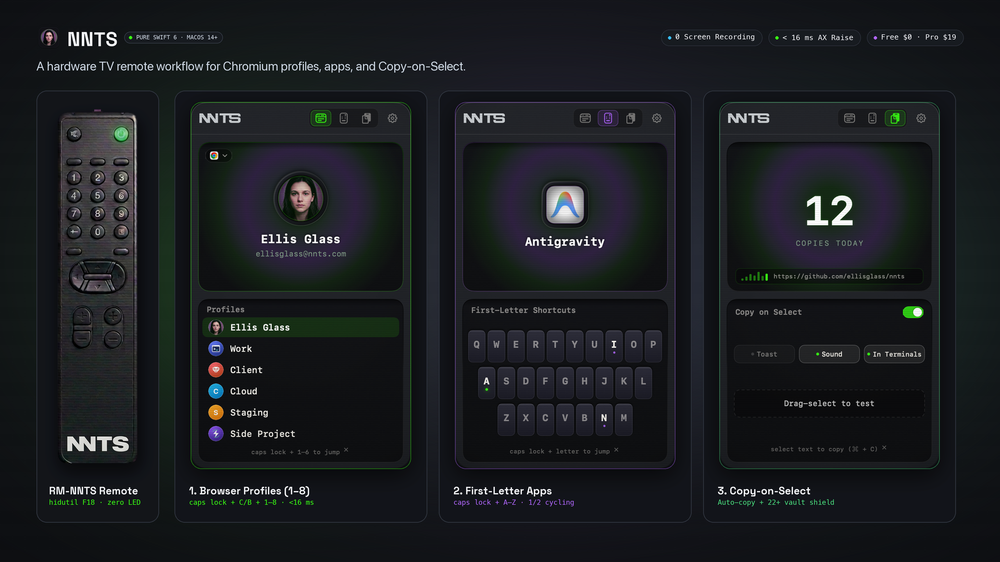

# NNTS

[](https://github.com/ellisglass/nnts/releases/latest)
[](https://ellisglass.github.io/nnts/)
[](LICENSE)

**Turn `caps lock` into a hardware TV remote for macOS.**
Jump straight to specific Chromium browser profiles with <kbd>caps lock</kbd> + <kbd>C</kbd>/<kbd>B</kbd> + <kbd>1..8</kbd> in under 16ms, launch or cycle apps by their first letter (<kbd>caps lock</kbd> + <kbd>[a-z]</kbd>), and copy highlighted text automatically without pressing <kbd>Cmd</kbd>+<kbd>C</kbd>.

**[Website & Interactive Workbench](https://ellisglass.github.io/nnts/)** · **[Download NNTS.dmg](https://github.com/ellisglass/nnts/releases/latest/download/NNTS.dmg)** · **[Unlock Pro ($19 Lifetime)](https://buy.polar.sh/polar_cl_v5lBa882Ea4dkTo9gvABMVxVbMgRyjkkhUcY43ktCAo)**

---

## Install (macOS 14.0+ Universal)

```bash
brew install ellisglass/tap/nnts
xattr -cr /Applications/NNTS.app
```

Or download **[NNTS.dmg](https://github.com/ellisglass/nnts/releases/latest/download/NNTS.dmg)** and drag `NNTS.app` into **Applications**.

> **First Launch (Gatekeeper Notice):** NNTS v1.0 ships locally signed without paid Apple Developer notarization. On first launch, either **right-click `NNTS.app` -> Open** in Applications, or run `xattr -cr /Applications/NNTS.app` once in Terminal.

---

<p align="center">
  
</p>

## Shortcuts & Channels

| Shortcut | Channel / Action | Details |
| :--- | :--- | :--- |
| <kbd>caps lock</kbd> + <kbd>C</kbd>/<kbd>B</kbd> + <kbd>1..8</kbd> | **Direct Profile Jump** | Focus an exact Chrome/Brave/Edge/Chromium profile window (<16ms via `kAXMenuBarAttribute`) |
| <kbd>caps lock</kbd> + <kbd>C</kbd>/<kbd>B</kbd> / Scroll | **Profile Cycle** | Toggle or scroll-pick between browser profiles via floating HUD |
| <kbd>caps lock</kbd> + <kbd>[a-z]</kbd> | **First-Letter App Jump** | Instant switch or deterministic `1/N` repeat cycling across shared-letter apps |
| **Mouse Drag / Multi-Click** | **Copy-on-Select** | Auto-copies selected text on mouse release with cursor toast and safety vault protection |

*Hold <kbd>caps lock</kbd> for the minimalist switcher bezel. Press <kbd>Esc</kbd> anytime to dismiss.*

---

## Free vs NNTS Pro ($19 Lifetime)

All acoustic feedback, trackpad haptics, driverless `caps lock -> F18` hardware remapping, and password-manager safety protections are **100% Free forever**.

| Feature | NNTS Free ($0) | NNTS Pro ($19 One-Time) |
| :--- | :--- | :--- |
| **Sound, Haptics & CRT Core** | Complete (`<16ms`, synthetic clicks) | Complete + v1.x updates |
| **Browser Profiles** | 2 profiles (`caps lock + 1-2`, Scroll) | Up to 8 profiles (`1-8`), Chrome/Brave/Edge/Chromium switcher, Avatar Capture Assistant |
| **Quick Apps (`[a-z]`)** | 5 pinned apps (Browser Hub free) | Unlimited across all 26 letters A-Z |
| **Copy-on-Select** | Auto-copy, Toast, Sound | + `In Terminals` chip, 7-day signal histogram & preview |
| **Safety Vault Immunity** | Full (22+ password managers, secure fields) | Full |
| **Finder Window Tidy** | Manual (`Tidy Now`) | Background auto-tidy daemon + `Tidy Now` |
| **Devices & Licensing** | No registration required | Offline Ed25519 license for up to 3 Macs |

---

## Architecture & Privacy Policy

* **Driverless Remap:** Physical `caps lock` maps to `F18` via macOS `/usr/bin/hidutil`. No kernel extensions, no green LED blink.
* **Sub-16ms Switching:** Head-insert `CGEventTap` routes hotkeys with <18 MB RAM and 0% idle CPU.
* **Zero Screen Recording Permission:** NNTS never calls screen capture APIs. Custom avatars import strictly from folders or clipboard paste (`⌘⌃⇧4`).
* **Zero Telemetry:** Zero analytics SDKs, zero keystroke logging, and zero background cloud sync. Offline Ed25519 keys validate without network calls; `Report Issue` builds a PII-sanitized zip locally only when you request it.

---

## Uninstall

```bash
brew uninstall nnts   # or delete /Applications/NNTS.app
```

---

## License

Proprietary software. Copyright (c) 2026 NNTS. All rights reserved. See [LICENSE](LICENSE) and [THIRD_PARTY_NOTICES](THIRD_PARTY_NOTICES).
